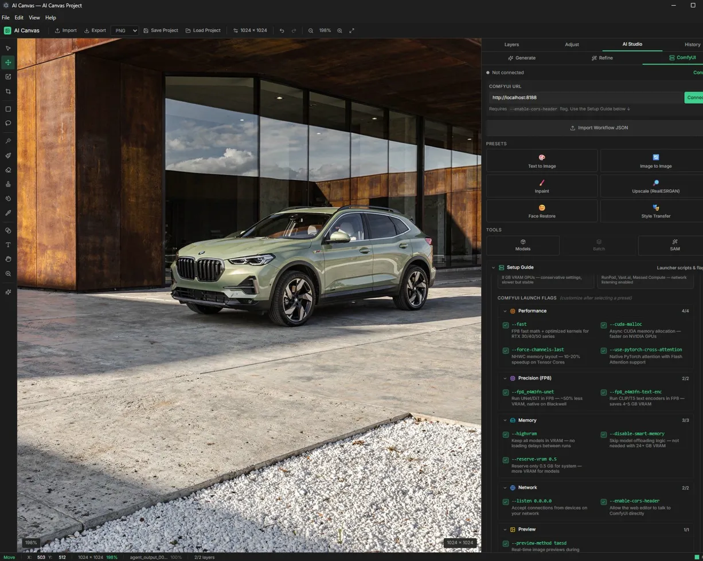

# AI Canvas Editor

A Windows-first desktop creative editor built with Electron, React, and TypeScript.

AI Canvas combines a high-performance 2D workflow with an optional Blender bridge for 3D-assisted pipelines.



## Highlights

- Infinite canvas editing with layered workflows
- Worker-backed image processing for heavy flatten/export operations
- GPU preview path (WebGL) with safe CPU fallback
- ComfyUI and Gemini AI workflow panels
- Optional Blender bridge:
  - Process control from inside the app
  - Embedded/detached Blender window management
  - Render/pass import with metadata
  - Camera state roundtrip
  - Sequence handoff and frame scrubbing

## Tech Stack

Electron · React 18 · TypeScript · Vite · Zustand · Tailwind CSS

## Quick Start (Windows)

**Prerequisites:** Node.js 20+, pnpm

```powershell
pnpm install
pnpm electron:dev
```

## Build

```powershell
# Web build
pnpm build

# Portable Windows .exe
pnpm electron:build
```

## Blender 3D Tab (Feature Flag)

Disabled by default. Enable via PowerShell before launching:

```powershell
$env:VITE_ENABLE_3D_TAB="true"
pnpm electron:dev
```

Or set in localStorage:
aiCanvas.flags.blender3dTab=true

## Status

- Phase 9 complete (9a–9i)
- Build pipeline: active
- Testing: manual smoke + phase checklists
